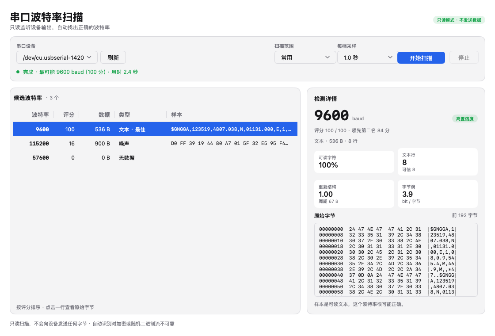
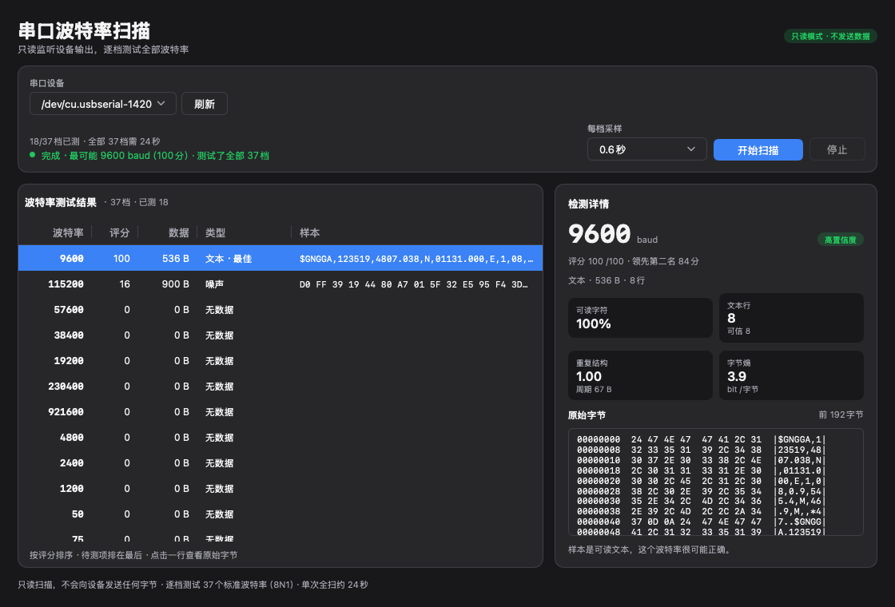
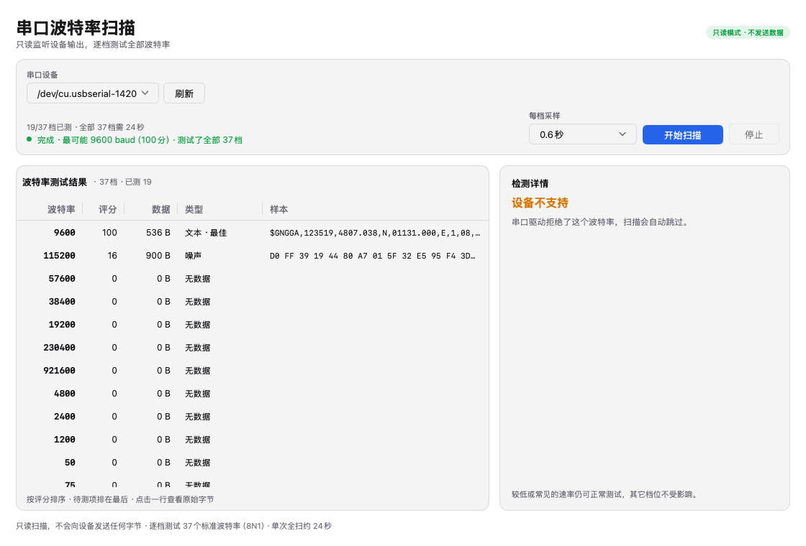

<p align="center">
 
</p>

<h1 align="center">BaudScan</h1>

<p align="center">串口波特率自动识别工具 ·只读扫描 ·跨平台原生界面</p>

<p align="center">
 <a href="LICENSE"></a>
 <a href="https://go.dev/dl/"></a>
 <a href="https://github.com/egoist/mygo"></a>
 
</p>

---

## 这是什么

把一台未知波特率的设备接到电脑串口，传统做法是一个个波特率手动尝试：改一次、看一眼、再改一次。**BaudScan 把这件事变成一次点击**：它枚举串口，按顺序切换全部 37 档标准波特率，对每一档收一段数据并打分，最后按可信度排序，告诉你最可能的波特率是多少，并给出原始字节供你确认。

工具**只读取串口，绝不向设备发送任何字节**，因此不会误触发命令、不会打断设备、不会写入配置。

<p align="center">
 
 
</p>
<p align="center"><sub>左：深色主题。右：串口驱动拒绝某档速率时的提示（macOS 上 230400 以上常见）。</sub></p>

## 功能

- **全量扫描**：一次走完 37 档标准波特率（50～4000000），不用先选范围。
- **自定义波特率**：在标准列表之外补充任意速率（如31250、10400），与标准档位一起扫描。
- **自定义帧格式**：数据位（5–8）、校验位（无 /奇 /偶 /标记 /空格）、停止位（1 /1.5 /2）可选，默认8N1。
- **只读**：不发送任何探测字节，只监听设备本来就在输出的数据。
- **单次打开**：整个扫描只 `open` 串口一次，之后仅切换波特率，避免反复开关触发开发板 DTR 复位。
- **实时填充**：表格在扫描前就列出全部档位，边扫边填，"待测"排在末尾。
- **可信度评分**：可读字符比例、文本行结构、周期性、字节熵综合打分，并给出"高、中、低置信度"。
- 前两名分差 ≤6 且都在 30 分以上时，界面标记“存疑”。
- **原始样本**：每档都能看十六进制 + ASCII 预览，支持选中复制。
- **驱动能力识别**：驱动拒绝的速率标为"不支持"，不计入错误、不影响其它档位。
- **可中断**：随时停止，已完成的结果保留。
- **跨平台原生**：Go + [mygo](https://github.com/egoist/mygo) 原生 UI，无 WebView、无前端构建、无 cgo。

## 截图

| 浅色 | 深色 |
| --- | --- |
|  |  |

## 下载与安装

从 [Releases](https://github.com/j4ckzh0u/BaudScan/releases)下载对应平台的 x64 产物：

| 平台 | 文件 | 说明 |
| --- | --- | --- |
| macOS（Intel） | `BaudScan-<version>-macos-x64.dmg` | 打开后把 BaudScan 拖入 Applications |
| Windows 10/11 x64 | `BaudScan-<version>-windows-x64.exe` | 单文件，双击运行，无控制台窗口 |
| Linux x64 | `BaudScan-<version>-linux-x64` | `chmod +x` 后直接运行，需要 GTK3 |

`SHA256SUMS` 内含三个产物的校验和：

```sh
shasum -a256 -c SHA256SUMS
```

> **macOS 提示**：当前发布包使用 ad-hoc 签名，未做 Developer ID 签名与公证。首次打开若被 Gatekeeper 拦下，右键点击 App → 打开，或在终端执行
> `xattr -dr com.apple.quarantine /Applications/BaudScan.app`。
>
> **Windows 提示**：exe 未做代码签名，SmartScreen 可能提示"未知发布者"，选择"更多信息 → 仍要运行"。
>
> **Linux 提示**：原生 UI 依赖 GTK3。Debian / Ubuntu 执行 `sudo apt install libgtk-3-0`；如需 `.deb` 与桌面入口，见 `build/release/linux-amd64/`（由 `mygo build` 生成）。没有串口权限时执行 `sudo usermod -aG dialout "$USER"` 后重新登录。

## 快速开始

1. 用 USB 转串口线或开发板把设备接到电脑。
2. 打开 BaudScan，在"串口设备"里选择端口；设备刚插入时点"刷新"。
3. 确认帧格式（数据位 /校验位 /停止位，默认8N1）；需要测标准列表之外的速率时填"自定义波特率"，如 `31250`。
4. 选择"每档采样"时长（默认1.0秒，全扫约39秒）。
5. 点"开始扫描"。
6. 看右侧详情：最可能的波特率、置信度、评分依据、原始字节。

常见设备（115200、9600、57600、38400、19200 等）排在最前面扫描，因此通常几秒内就能看到正确结果，无需等全扫结束。

### 采样时长怎么选

| 每档采样 | 全扫耗时 | 适用 |
| --- | --- | --- |
| 0.4 秒 | 约 24 秒 | 高频、连续输出的设备（日志流、传感器） |
| 0.6 秒 | 约 27 秒 | 大多数设备 |
| 1.0 秒 | 约 39 秒 | 默认，每秒一行左右的设备 |
| 2.0 秒 | 约 78 秒 | 慢速周期输出（2 秒一次） |
| 5.0 秒 | 约 195 秒 | 极慢周期、或只在开机时吐一小段 |

扫描会在"已经收到数据、并且之后安静了 140 ms"时提前结束该档，所以输出密集的设备实际耗时会短于上限。

## 工作原理

### 1.打开与切换

以 `8N1` 打开串口，等待 220 ms 让可能因 DTR 复位而重启的板子启动完，清空输入缓冲。之后每换一档波特率：

- 调用驱动的速率设置接口；
- 静置 45 ms，清空缓冲（丢弃上一档速率残留的字节）；
- 开始采样窗口。

### 2.采样窗口

读取最长一个"每档采样"时长；满足下列任一条件即结束：

- 已收到数据，且连续 140 ms 没有新字节，且已采样至少 320 ms；
- 达到采样上限时长；
- 累计 256 KiB（保护内存）；
- 用户点了"停止"。

### 3.评分

对采样到的字节计算四组统计量，再合成两个假设的分数，取较高者：

**文本假设**（正确的波特率通常把 ASCII / UTF-8 还原成可读文本）

```
text = clamp((可读字节占比 -0.42) /0.53)  #随机字节约0.4
repeat = clamp((周期性 -0.01) /0.16)
entropy = clamp((7.75 -字节熵) /2.6)
clean = 1 - clamp(控制字节占比 /0.18)
distinct = clamp((不同字节数 -1) /8)

TextScore = 100 x (0.55*text +0.18*行结构 +0.10*repeat +0.10*entropy +0.07*clean)
 x (0.72 +0.28*distinct)
```

**二进制假设**（部分设备输出定长帧，帧头重复但没有可读文本）

```
BinaryScore = 100 x (0.68*repeat +0.14*entropy +0.12*二进制干净度 +0.06*distinct)
```

其中"周期性"取 2～384 字节滞后区间内最高的字节重合率：真实协议的帧头、定长行会在这个区间反复出现，而错误波特率产生的随机字节不会。

另外几条规则：

- 不同字节数 ≤2 且长度 ≥6 → 判定"恒定电平"，得分 0（空数据、全 0、全 FF 都没有信息量）。
- 数据过短会压低得分上限（<2 字节记 0，<4 字节 ≤30，<8 字节 ≤50，<16 字节 ≤70）。
- 分数 <20，或文本特征极弱且二进制分数 <25 → 判定"噪声"。
- 前两名分差 ≤6 且都在 30 分以上时，界面标记“存疑”。

这些权重来自对文本流、UTF-8 中文流、随机噪声、恒定电平、定长二进制帧的单元测试与真实设备采样调参；它终究是启发式判断，不保证 100% 正确。

### 4.排序

先按分数降序；同分时按扫描顺序（常用速率优先）；未测的档位排在已测之后。

## 支持的波特率

37 档标准速率，升序：

```
50,75,110,134,150,200,300,600,1200,1800,
2400,4800,7200,9600,14400,19200,28800,38400,
57600,76800,115200,128000,230400,250000,256000,
460800,500000,576000,921600,1000000,1152000,
1500000,2000000,2500000,3000000,3500000,4000000
```

扫描顺序把常用速率提前：`115200,9600,57600,38400,19200,230400,921600,4800,2400,1200`，其余按升序补齐。

### 自定义波特率

界面"自定义波特率"里可以填入标准列表之外的速率，如 `31250`（MIDI）或 `10400`（部分电表）；
多个用逗号、分号或空格分隔。它们排在常用速率之后、其余标准速率之前，重复的速率只测一次。
输入无法解析或超出 `1…20000000`时，提示行变红并禁用"开始扫描"，已有结果保留。

### 数据位 /校验位 /停止位

三个下拉框选择串口帧格式，默认 `8N1`。全部37档速率在同一帧格式下测试：
错误的帧格式会让每一档都读成乱码，因此帧格式由你指定，而不是自动探测。
`1.5`停止位只有 Windows支持，Linux会返回"此设备不支持该停止位"，macOS视驱动而定。
改动帧格式会清空已有结果，因为它们是在旧格式下采样的。

各平台设置非标准速率的方式：

| 平台 | 机制 | 备注 |
| --- | --- | --- |
| Linux | `termios2` + `BOTHER` | 任意速率；需要内核支持 |
| macOS | `IOSSIOSPEED` ioctl | 取决于串口驱动；FTDI / CH34x / CP210x 通常支持到 921600 或更高，部分内置驱动只到 230400 |
| Windows | `DCB.BaudRate` | 由驱动决定实际上限 |

驱动拒绝的速率会显示为"不支持"，扫描继续。

### 已知限制

- **不自动探测帧格式**。数据位 /校验位 /停止位需要手动指定；选错时所有档位都会读成乱码或低分。
- **要求设备主动输出**。工具不发送任何字节，只回应命令的设备收不到样本。
- **加密 / 压缩 / 高效随机化**的输出没有可利用的统计特征，无法判断。
- **极低占空比**的一次性开机消息可能被采样窗口错过；请增大采样时长后重扫。
- **一档速率可能同时"读起来像文本"**：例如真实 9600 的数据在 19200 下常常也是可读字符（只是乱码）。此时看分差与原始样本，不要只看排名。

## 常见问题

**为什么打开串口后设备重启了？**

串口打开时驱动通常拉高 DTR，很多开发板（Arduino、ESP32、STM32 最小系统板）把它接到复位。BaudScan 只在开始扫描时打开一次串口，因此最多复位一次，而不是每档一次。

**为什么某些高速率显示"不支持"？**

驱动拒绝设置该速率。换用支持高速率的 USB 转串口芯片（FTDI FT232H、CP2102N、CH343 等）通常可以解决。

**为什么全是"无数据"？**

设备没有主动输出、TX/RX 接反、地线未接、或采样太短。先确认用其它工具在已知波特率下能看到数据，再回来扫描。

**为什么最佳结果不是 100 分？**

评分是相对指标：文本越规整、行结构越完整、重复结构越明显，分数越高。短样本、单行输出、纯二进制帧都会压低分数，但不代表结果错误。

**可以扫描非标准波特率吗？**

可以。在"自定义波特率"里填入速率（逗号分隔），无需重新构建；它们会和37档标准速率一起扫描。

**为什么换了帧格式后结果全空了？**

已有样本是在旧帧格式下采样的，格式变了就不再有效，因此会自动清空并等待重新扫描。

**会修改设备吗？**

不会。工具只调用 `read` 和速率设置，不调用 `write`；代码中不存在写路径。

## 开发

### 环境要求

- Go **1.27.3+**（`go.mod` 会通过 `GOTOOLCHAIN=auto` 自动下载）
- 原生 UI 不需要 Bun、Node 或任何前端工具链
- 打包 macOS DMG 需要 macOS（`hdiutil`）；Windows 安装器需要 NSIS（可选）

### 常用命令

```sh
go tool mygo dev # 开发模式：构建开发版 App，改 .go 后自动重启
go test ./... # 单元测试与模拟串口集成测试
go vet ./... # 静态检查
go test -race ./... # 竞态检测

go tool mygo build # 打包当前平台（macOS 生成 .app + .dmg）
open build/darwin-amd64/BaudScan.app
```

> macOS 上请通过 mygo 生成的 `.app` 运行：直接 `go run .` 或裸二进制不会创建原生窗口。

### 一键构建 x64 发布包

```sh
./build.sh
```

脚本执行一次 `go tool mygo build -platform darwin/amd64,windows/amd64,linux/amd64`，然后校验并归一化产物：

| 产物 | 内容 |
| --- | --- |
| `dist/BaudScan-<version>-macos-x64.dmg` | 经 `hdiutil verify`校验的磁盘镜像 |
| `dist/BaudScan-<version>-windows-x64.exe` | 校验为 `PE32+ executable (GUI) x86-64` |
| `dist/BaudScan-<version>-linux-x64` | 校验为 `ELF64-bit LSB executable, x86-64`，已加执行位 |
| `dist/SHA256SUMS` | 三个产物的 SHA-256 |

中间产物（含 Linux `.deb`、`.tar.gz`、`install.sh`、`.app`）保留在 `build/release/`。任一产物缺失或类型不符时脚本立即失败。

### 手动交叉编译

项目不依赖 cgo，任何平台都能构建三个平台的可执行文件：

```sh
CGO_ENABLED=0 GOOS=darwin GOARCH=arm64 go build -o dist/baudscan-darwin-arm64 .
CGO_ENABLED=0 GOOS=darwin GOARCH=amd64 go build -o dist/baudscan-darwin-amd64 .
CGO_ENABLED=0 GOOS=windows GOARCH=amd64 go build -ldflags "-H windowsgui" -o dist/baudscan-windows-amd64.exe .
CGO_ENABLED=0 GOOS=linux GOARCH=amd64 go build -o dist/baudscan-linux-amd64 .
```

### 运行环境

- macOS 12+（原生 UI 使用 Metal）
- Windows 10/11（原生 UI 使用 Direct3D11）
- Linux x64 / arm64（原生 UI 需要 GTK3）

## 项目结构

```
.
├── main.go窗口入口与生命周期
├── app.go界面状态、扫描编排、端口刷新、结果选择
├── view.go mygo原生 UI（布局、表格、详情面板）
├── app_test.go状态机测试
├── view_test.go视图测试（含截图导出）
├── internal/baud/
│ ├── scan.go串口采样：打开一次、逐档切换、提前结束
│ ├── analyze.go统计量与评分（文本 /二进制 /噪声 /恒定）
│ ├── format.go预览、十六进制转储、单位格式化
│ ├── frame.go帧格式（数据位 /校验位 /停止位）与自定义速率解析、扫描顺序
│ ├── scan_test.go模拟串口集成测试
│ ├── frame_test.go帧格式与速率解析单元测试
│ ├── frame_scan_test.go帧格式在真实扫描路径上的测试
│ ├── analyze_test.go评分单元测试
│ ├── pty_live_test.go真实 serial.Open路径测试（socat PTY，可选）
│ └── unsupported_test.go驱动拒绝速率的判定
├── internal/ports/纯 Go串口枚举
│ ├── ports.go排序与自然序比较
│ ├── ports_darwin.go /dev/cu.*
│ ├── ports_linux.go ttyUSB / ttyACM / ttyS / rfcomm等
│ ├── ports_windows.go注册表 SERIALCOMM
│ └── ports_test.go
├── design/icon.svg图标源文件
├── resources/icon.png1024×1024图标，mygo据此生成 .icns / .ico
├── docs/截图
├── build.sh x64一键发布脚本
├── mygo.json应用名、标识、版本、发布者
├── go.mod / go.sum依赖与工具版本锁定
└── LICENSE MIT
```

### 依赖

| 模块 | 作用 |
| --- | --- |
| [`github.com/egoist/mygo`](https://github.com/egoist/mygo) | 原生 UI 与打包工具链（`go tool mygo`） |
| [`go.bug.st/serial`](https://github.com/bugst/go-serial) | 跨平台串口读写与速率设置 |

`internal/ports` 不依赖 `go.bug.st/serial/enumerator`，因为它使用 cgo；这里是纯 Go 实现，保证可从任意平台交叉编译。

## 图标

`design/icon.svg` 是图标源文件。画布 1024×1024 透明，圆角主体 824×824 居中，四周各留 100 px，内容占画布约 79.2% ——与 macOS 自带图标的网格比例一致（`Mail`、`Notes` 实测同为 79.2%），因此 Dock、Finder 与"关于"窗口里的视觉尺寸和其他应用相同。波形笔画 48 px，缩到 48×48 仍可辨认。

修改后重新导出：

```sh
rsvg-convert -w1024 -h1024 design/icon.svg -o resources/icon.png
go tool mygo build
```

`mygo build` 会从 `resources/icon.png` 生成 macOS 的 `.icns`（32/64/128/256/512/1024）和 Windows 的 `.ico`（16/24/32/48/64/128/256）。

## 测试

```sh
go test ./... # 54 项，覆盖 3 个包
go test -race ./...
go vet ./...
```

覆盖范围：

- **评分**：标准文本、UTF-8 中文、随机噪声、恒定电平、定长二进制帧；预览与十六进制转储格式。
- **排序**：同分时常用速率优先、未测档位排末尾；自定义速率进入扫描顺序且去重。
- **扫描**：用模拟串口为每档提供不同数据，验证能从噪声中选出 9600；覆盖取消、无数据、`SetMode` 失败继续、采样提前结束。
- **帧格式**：`8N1 /7E2 /8O1.5` 等标签往返、`Frame.Mode`、扫描时用于 `Open` 与每次 `SetMode`；
 自定义速率解析（含中文分隔符与越界拒绝）。
- **驱动拒绝**：`EINVAL` 与无效数据位 / 校验位 / 停止位判定为"不支持"而非错误。
- **界面状态**：端口刷新 /保留 /消失、结果填充、最佳行跟随与手动锁定、无数据、深色主题、最小窗口尺寸；
 帧格式与自定义速率控件、输入生效、非法输入提示。
- **真实 I/O 路径**（可选，需 `socat`）：验证真实的 `serial.Open`、`SetMode`、清缓冲与读取。

```sh
socat pty,raw,echo=0,link=/tmp/baudscan-pty-a pty,raw,echo=0,link=/tmp/baudscan-pty-b

BAUDSCAN_PTY=/tmp/baudscan-pty-a BAUDSCAN_PTY_PEER=/tmp/baudscan-pty-b \
 go test ./internal/baud -run TestLivePTY
```

PTY 会原样传递字节，因此这项测试只验证驱动层调用路径，不验证波特率判别本身。

## 免责声明

波特率识别基于统计启发式判断，**不保证正确**。请结合原始字节、设备手册与协议文档确认后再用于生产环境。串口打开可能触发设备复位，请在允许重启设备的场合使用。

## 许可证

[MIT](LICENSE) ©2026 j4ckzh0u
